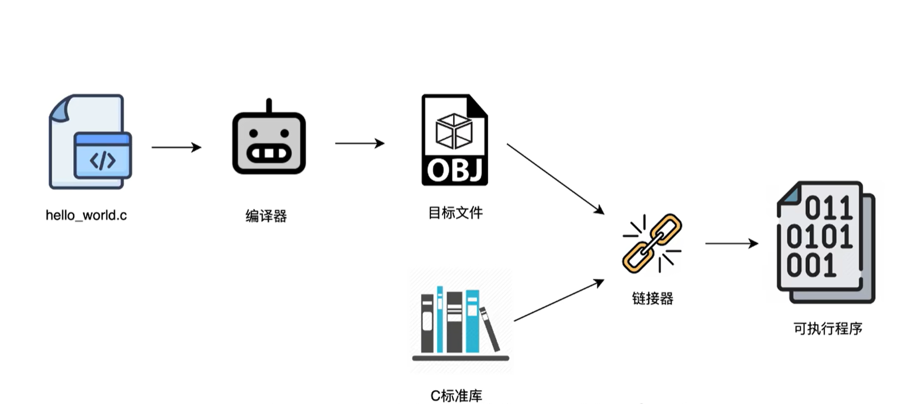

#### TASK0
>## 编译器
## Q 1
### Q 1.1 编译器（compiler）解析器（parser）

编译器是一个完整的系统，包含了前端中端后端。
而解析器是它前端的一个“语法分析器”负责检查编译代码语法上是否存在错误，从而阻碍成功编译，并且按照语法优先级“捋一遍”整体的程序，生成所谓的AST抽象语法树，使后续编译流程继续进行。（解析器只查语法不查语义）

在这里我们还需要区分解释器（interpreter）和解析器（parser），
编译器和解释器为两种宏观上不同的系统，它们两者有着不同的运行逻辑，大体上看，
- 在程序运行上，编译器是先全部翻译为机器语言再交给其运行，而解释器则是一步一步将程序中的指令给到机器；
- 然后编译器通常会产生一个类似于.exe/.o的最终可执行文件/中间目标文件而**解释器不会**；
- 在报错上面，编译器会在编译过程中就意识到错误并全部显示出来，错误没有改正就不能够运行，而解释器类似于“走一行看一行”，如果此行报错就无法进行到下一行;
- 比如c/c++就是编译器，python是解释器。
### Q 1.2 AOT (ahead of time) JIT (just in time)

二者均为编译器后端的不同执行策略，区别在于翻译成机器码的时机
- AOT策略类似于在程序运行之前将其翻译完，优点在于执行速度快
- JIT则会在程序运行时翻译，并还以“旁观者”的姿态观察，如果某一个行为运行太多次达到阈值，它就会将这段热点代码编译成机器码并缓存，后续直接执行机器码，从而减少‘逐行解释’的时间，大幅提升运行速率
- 实际应用过程中二者可以灵活使用，比如JIT用于开发模式可以立刻看到效果（执行效率不如AOT但开发效率更高）；而AOT在用户环境里则可以有启动更快，运行更流畅的效果
- 还有像Java、Flutter这类采用了混血模式
（解释器不会生成中间文件）
### Q 1.3 链接器（linker）
在生成形如.o的可执行文件后，我们需要执行它，这个时候就要使用链接器将其与C语言标准库（以及项目中的其他目标文件/第三方库）链接起来，拼成一个成品。

（*比如说printf函数在程序中并没有人为定义，就需要到C标准库里面去调用这个函数*）

### Q 1.4 C语言的步骤
1. 预处理：处理宏定义和头文件，生成 .i 文件
2. 编译：使用编译器，将预处理后的代码翻译成汇编代码（.s），解析器（Parser）发挥作用
3. 汇编：使用汇编器，将汇编代码翻译成机器码，生成目标文件（.o）
4. 链接：使用链接器（Linker），将目标文件与系统库（如 printf 的实现）拼装在一起，解决地址引用，最终生成可执行文件（.exe）
## Q 2 GCC与LLVM
- GCC类似于一个封闭的管道，尽管它现在能够适配多种语言，可是它的内部架构仍然紧紧地“焊”在一起，也具有多种IR但是并未开放成外界接口
- LLVM诞生比GCC略晚，最大的不同就是有一个LLVM IR的标准接口，使得不同语言可以比较容易地与其协同工作
- 这两者的特性决定了在创新上LLVM远比GCC更加容易，因为不用大幅度地更改内部架构，只需形成一个适配的接口；但是牺牲了灵活性的GCC则拥有更强的稳定性与兼容性

*（由于GCC的诞生时间较早，所以很多较为老旧系统的维护也会用到GCC）*
*（并且由于GCC的GPL许可证，许多大型公司为了避免自己的创新代码被开源，反而会选择LLVM）*
*(clang在LLVM中的前端，主要针对C家族，虽说它属于LLVM，但开发者为了便于GCC迁移模仿了它的一些命令行参数)*
## Q 3 LLVM IR 的特性
### Q 3.1 SSA(静态单赋值)
在C语言的写作中我们经常会对于一个自变量进行多次赋值，但当我们如果想要进行回溯的时候，会发现历史一片乱、难以追踪，于是就引入了SSA。在它的规则下，每个变量只能被赋值一次，形式和初中的多元方程有些相像（注意只是视觉上看起来实际上并没有什么关系）
e.g.
```
x1 = 10;
x2 = x1 + 5;
x3 = x2 * 2;
y1 = x3 + 1;
```
然后就会比较便于追踪啦。（通过use-def链（*从一条使用结果出发，找到“来自哪里”*）
### Q 3.2 PHI（Φ）节点
- SSA固然好，但在if-else语句中会出现问题，比如
```
if (...) { x = 10; } 
else { x = 20; }
y = x + 5;
```
那这种情况在SSA的规则下,x1和x2就会在汇合点发生冲突，我们就引入了PHI
它起到的作用就是引入一个虚拟变量，使得定义的x3在不同的情况下能够被赋予不同的值
- 在循环语句中，它的作用更为明显，它需要将“循环开始前的初始值”和“上一圈循环结束后的更新值”合并在一起
它同样会在意你从哪条“路”走过来，每一次进入循环，都会自动选择最新的变量版本

**这里需要辨别，可能会有疑惑在于“每一次进入循环时不会覆盖掉上一次的值吗”，但事实上，“覆盖”这个状态和专门的寄存器有关**

**循环内部，SSA只需要认准变量值就可以了，PHI起到一个“引入”的作用，而真正的循环运行变量“覆盖”的动作会在后期进行**

*LLVM IR本身使用的是以%字符命名的临时寄存器*
### Q 3.3 CFG（Control Flow Graph）
1. instruction（指令）：顾名思义，单独的一个“动作”
2. basicblock（基本块）：由一连串的指令构成，且不具有分支功能，**遇到分支/跳转就结束**
3. function（函数）：不同的基本块按顺序组合起来，构成了一个函数，而CFG就是描述“组合”这一关系的
（CFG类似于function的“说明书”，一个函数对应一个CFG，而CFG就是通过“连线”决定基本块之间的关系）
4. module（模块）：一个编译单元为一个模块，其中有不同的函数
---
- CFG的切分法则：
 
 基本块的开头：寻找（leader）领头指令的原则：
1. 函数的入口：整个函数的第一条指令，必然是第一个基本块的开头。
2. 跳转的目标：任何 br（跳转）指令指向的那个标签，必然是某个块的开头。因为要接收外部跳转指令，它必须是一个独立的入口。
3. 跳转的后一条指令：紧跟在跳转指令后面的那条指令。虽然前面的跳转走了，上一个基本块已经结束，下一行必须开启一个新的基本块。

 基本块的结束：寻找（Terminator）终结指令的原则：
 以“不拐弯，不分叉”为准则，
1. br（跳转）：无论是无条件跳转还是条件跳转。
2. ret（返回）：函数执行结束，返回。
3. switch（多分支）：根据值跳转到多个不同块。
4. unreachable：不可达指令。

- CFG的连接准则：主要看终结指令
顺序连接/分支连接/汇合连接/终止连接

连接结束后，每个块就有了自己的前驱（Predecessor）和后继（Successor）
以及整体的CFG就拥有了入口块（entry block）和出口块（exit block）

* 前面提到的PHI节点也和前驱的路径判断有关
### Q 3.4 value/use/user
我们可以认为，value指代的就是一个“东西”————一切可以被使用（use）的，就是value，是一个通用的泛称
*比如我们之前提到的instruction，basicblock等都是value*
那么use/user就分别是“使用”这一个动作，以及“使用者”。（user也可以是一个value）
use-list则是用来记录use这样一个动作的表，顺着这个表，可以找到user
在前文SSA的部分我们提到了def-use链，那么它其实是从value出发，顺着它身上携带的use_list，向下找出所有使用了它的user
而反过来，同样有use-def链，从当前User出发，顺着它引用的 Use关系，向上回推Value是由哪条指令（Def）产生的。
在 SSA 规则下，由于每个变量只赋值一次，这个追溯是极其直接且高效的。（SSA部分也提到过一嘴）
### Q 3.5 pass
一个pass就是对IR的一次遍历和处理。它接收IR作为输入，执行某种分析或变换，输出修改后的IR
pass可以分成两类：分析和变换
- 分析pass：只读取IR、提取信息，不修改代码；
- 变换pass：修改IR
### Q 3.6 CFG遍历与侵入式链表
CFG遍历是根据CFG的控制流图，按照每个basicblock的连接准则，将每一个basicblock过一遍，并检查里面的指令。
其中有两种策略，深度优先（DFS）和广度优先（BFS）。
而为了遍历所有的basicblock，就需要找到每个块的前驱和后继
侵入式链表则是通过在每一个basicblock中自带的prev和next指针，从物理内存层面上就将它们串起来、形成链表，才有了“侵入式”的说法。
因为链表指针是直接“侵入”并嵌入到数据结构内部的，省去了额外的节点包装，所以它使得LLVM的运行更加高效。
## Q 4 数据流中的 User 与 CFG 结构的对应
数据流图（Data Flow Chart）反映的是变量怎么产生和消耗，而 CFG（控制流图）反映的是代码怎么执行。这两张图相互交织
数据流图（DFG）中的user和use，在 CFG 中是由基本块中的instruction来实现的。每一条instruction都继承自user,instruction 是数据流 User的载体,但 User 不只有 Instruction
## Q 5 前中后端的流程
我们综合前文提到的所有概念，可以大致理出有关前端中端后端的关系
1. 前端：看懂代码，查错，并翻译成统一的LLVM IR
* 解析器（Parser）：负责词法分析、语法分析，生成AST
* AST（抽象语法树）：承载代码的静态语法结构，解析器在此阶段抓语法错误
* clang：LLVM生态中负责C/C++的前端工具
2. 中端：逻辑优化，让代码变短、变快
* LLVM IR：中端的绝对核心载体（其实它贯穿前中后，但在中端被大肆加工）
* module/function/basicBlock/instruction：IR 的四大层级骨架
* SSA：IR 必须遵守的最高法则
* PHI节点：解决分支冲突，维护 SSA 规则的补丁
* CFG：中端优化时的“流程图”
* value/user/use & 侵入式链表：中端数据流追踪的底层数据结构
* pass：对IR的遍历处理
3. 后端：对接物理硬件（CPU），把 IR 变成机器码
* 寄存器分配：把中端“无限的虚拟变量”塞进“有限的物理寄存器”里
* AOT / JIT：生成机器码的时机策略。AOT 在后端提前编译好生成 .o，链接后形成.exe；JIT 在运行时再调起后端生成机器码
* 指令选择：把LLVM 的通用伪指令（IR），映射成目标 CPU对应的机器指令
* 指令调度：重排机器指令顺序，适配 CPU 流水线，减少等待延迟

有些概念是贯穿全场的，比如：
* Pass：前端也有 Pass（比如把 AST 变成 IR 的 Pass），后端也有 Pass（比如指令选择的 Pass）。它无处不在。
* Value：在前端叫表达式，在中端叫虚拟变量，在后端被映射到物理寄存器。